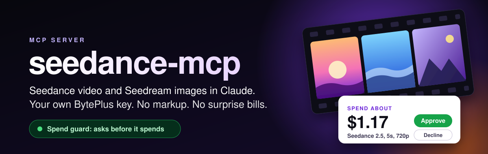
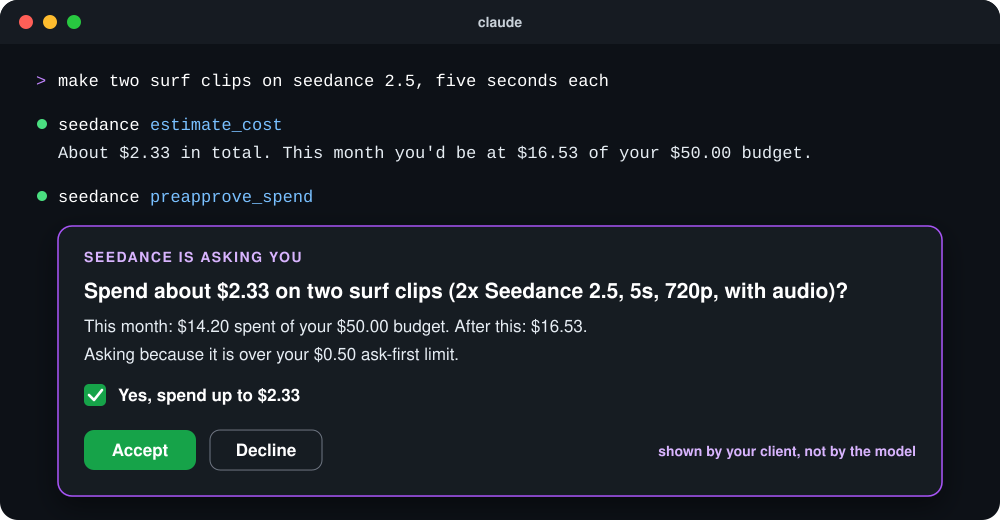

<p align="center">
  
</p>

<p align="center">
  <b>ByteDance's Seedance 2.5 video and Seedream 5 images, inside Claude.</b><br>
  On your own BytePlus key, at list price, with a spend guard that asks before it burns your money.
</p>

<p align="center">
  <a href="https://github.com/atharva3vedi/seedance-mcp/actions/workflows/ci.yml"></a>
  
  
  
</p>

---

## Why this exists

I asked Claude to make a short series of video reels. 61 clips and four rounds of revisions later it had burned through 10.3 million Seedance tokens. I found out what that meant from the bill: **about $100**.

The agent did nothing wrong. It reported tokens, and tokens mean nothing to a human. Dollars do.

So this server prices every request in dollars **before** it is sent, lets the cheap stuff through, and stops to ask you when it matters. Not in a log. Not on the invoice. Before the money is gone.

<p align="center">
  
</p>

## What you get

| | |
|---|---|
| **Video** | Seedance 2.5, 2.0, 2.0 Fast and 2.0 Mini. Text to video, first and last frame, reference images, reference videos, reference audio. |
| **Images** | Seedream 5.0 Pro, Flash and Lite (plus 4.5 and 4.0). Up to 10 reference images, up to 15 related images per call. |
| **Spend guard** | A dollar estimate on every call, an ask-first limit, a budget per day, week or month, and an optional hard cap. |
| **Real approvals** | A dialog drawn by your MCP client that the model can't click for you. A chat fallback everywhere else. |
| **Batch approval** | One yes for a whole shoot. Each clip draws from the approved amount and can't go past it. |
| **Whole-key tracking** | Counts what your key spent from any tool or script, not just this server. |
| **No babysitting** | `wait=true` blocks until the video is done. `save_to` keeps a copy before the 24 hour link expires. |
| **Errors with fixes** | Face policy, model activation and moderation errors come back with what to do next. |

## Quick start

**1. Get a key.** Sign up at [BytePlus](https://www.byteplus.com), open ModelArk, activate the Seedance and Seedream models under *Model activation > Media* (free, you pay per generation), then create a key under *API Key Management*.

**2. Add the server.** For Claude Code:

```bash
claude mcp add seedance --scope user -e ARK_API_KEY=your-key -- uvx --from git+https://github.com/atharva3vedi/seedance-mcp seedance-mcp --budget 50
```

For Claude Desktop, Cursor, Windsurf or any other MCP client, add this to its MCP config:

```json
{
  "mcpServers": {
    "seedance": {
      "command": "uvx",
      "args": ["--from", "git+https://github.com/atharva3vedi/seedance-mcp", "seedance-mcp", "--budget", "50"],
      "env": { "ARK_API_KEY": "your-key" }
    }
  }
}
```

No `uv`? Run `pip install git+https://github.com/atharva3vedi/seedance-mcp` and use `seedance-mcp` as the command.

**3. Ask for something.**

> make a 5 second clip of a cat surfing at sunset, draft quality first

Claude drafts it on Seedance 2.0 Mini at 480p (about $0.17), waits for it, and hands you the file.

## The spend guard

Every generation is priced before it leaves your machine. Then:

| Situation | What happens |
|---|---|
| Under your ask-first limit and inside your budget | Goes straight through. The cost is in the result. |
| Over the ask-first limit | Asks you first. |
| Would take you past your budget | Asks you first, even for a $0.09 image. |
| No price on file for the model | Asks you first, and says the cost is unknown. |
| Would go past your hard cap | Refused. No approval can override it, only a config change. |

### How it asks

**In a dialog** when your client supports [MCP elicitation](https://modelcontextprotocol.io/specification/draft/client/elicitation) (Claude Code 2.1.76 and later, among others). The server asks your client directly, your client shows you the dialog, and the answer comes from you. The model never sees a button it could press.

**In chat** everywhere else. The tool returns `needs_your_ok` with a one-time `approval_id` and the exact sentence to show you. Claude has to ask, and only after you say yes can it call again with that id. Each id is tied to that exact request: change the prompt, the model or the duration and it stops working. It expires after 15 minutes.

> Chat approvals rely on the agent following instructions. Dialog approvals don't. Set `--approval dialog` to forbid the chat path entirely.

### Batches

Before a shoot, Claude calls `estimate_cost` to tell you the total, then `preapprove_spend` to ask once:

```
Spend about $2.33 on two surf clips (2x Seedance 2.5, 5s, 720p, with audio)?
This month: $14.20 spent of your $50.00 budget. After this: $16.53.
```

You get back an `approval_id` that covers up to that many calls and that many dollars for 3 hours. A third clip, or a pricier one, needs a new yes.

### It sees everything on your key

Before deciding, the server pulls your recent tasks from BytePlus, so clips made by scripts, other agents or another Claude window all count toward the budget. Images and older tasks live in a local ledger at `~/.seedance-mcp/ledger.jsonl`, which every session shares.

Check your spend from a terminal any time:

```bash
seedance-mcp spend
```

```
seedance-mcp: this month
  $14.20 of $50.00  [######..............] 28%
  ask first above $0.50, hard cap none
    Seedance 2.5           11     $13.84
    Seedream 5.0 Pro        4      $0.36
```

### Settings

Pass flags after `seedance-mcp`, or set environment variables. You can also keep them in `~/.seedance-mcp/.env` (see [`.env.example`](.env.example)), which keeps your key out of every repo.

| Flag | Environment | Default | |
|---|---|---|---|
| `--ask-above` | `SEEDANCE_ASK_ABOVE_USD` | `0.50` | Ask before any single generation above this. `0` asks every time. |
| `--budget` | `SEEDANCE_BUDGET_USD` | `20` | Ask before anything that crosses this... |
| `--period` | `SEEDANCE_BUDGET_PERIOD` | `month` | ...per `day`, `week` or `month`. |
| `--hard-cap` | `SEEDANCE_HARD_CAP_USD` | none | Never spend past this in a period. |
| `--approval` | `SEEDANCE_APPROVAL` | `auto` | `auto` (dialog, else chat), `dialog`, `chat`, or `off` (track only). |
| `--output-dir` | `SEEDANCE_OUTPUT_DIR` | none | Save every finished video and image here. |
| | `SEEDANCE_VIDEO_MODEL` | `mini` | Default video model. |
| | `SEEDANCE_IMAGE_MODEL` | `pro` | Default image model. |
| | `SEEDANCE_PRICES_FILE` | none | JSON with extra or corrected prices. |
| | `ARK_BASE_URL` | Singapore | ModelArk endpoint. |

## What things cost

BytePlus list prices as of October 2026, for a clip without reference video:

| Model | Alias | 5s 480p | 5s 720p | 10s 720p | 5s 1080p |
|---|---|---|---|---|---|
| Seedance 2.5 | `2.5` | $0.52 | $1.17 | $2.32 | $2.87 |
| Seedance 2.0 | `2.0` | $0.34 | $0.76 | $1.52 | $1.89 |
| Seedance 2.0 Fast | `fast` | $0.27 | $0.61 | $1.21 | |
| Seedance 2.0 Mini | `mini` | $0.17 | $0.38 | $0.76 | |

Seedream 5.0 Pro is $0.045 per image up to 1.5K and $0.09 above. Flash is $0.018, Lite $0.035. Failed and moderated generations are free.

Estimates use the formula BytePlus bills with, `(input video seconds + output seconds) x width x height x 24 fps / 1024` tokens plus one frame, and match real usage to the token. Prepaid token packs and discounts aren't reflected. If prices change before this table does, point `SEEDANCE_PRICES_FILE` at a JSON file:

```json
{
  "video": {
    "dreamina-seedance-2-0-mini-260615": {
      "name": "Seedance 2.0 Mini", "max_input_video_seconds": 15,
      "rates": { "sd": [3.5, 2.1] }
    }
  }
}
```

`rates` are USD per million tokens, `[without video input, with video input]`, keyed by `sd` (480p and 720p), `1080p` and `4k`.

## Tools

| Tool | What it does |
|---|---|
| `generate_video` | Make a Seedance clip. Plain arguments (`prompt`, `first_frame`, `reference_videos`...), and local image paths work. `wait` and `save_to` are optional. |
| `generate_image` | Make Seedream images from a prompt and up to 10 references. |
| `video_task` | Status of a clip. Once done: the link, the real cost, and the saved file. |
| `list_video_tasks` | Recent clips on your key, with what each one cost. |
| `cancel_video_task` | Cancel a queued clip. |
| `estimate_cost` | Price a plan in dollars without spending anything. |
| `preapprove_spend` | One approval for a whole batch. |
| `spend_status` | Spent so far, by model, against your budget. |
| `check_setup` | Is the key good, can it connect, and will approvals come as a dialog or in chat. |

## Tips that save money

- **Draft on Mini at 480p**, then render the keeper on 2.5. A Mini draft costs about a seventh of a 720p render on 2.5.
- **Reuse instead of re-rendering.** Trim, re-time and re-caption clips in an editor. A re-shoot costs the full price again.
- **Faces:** Seedance 2.x rejects realistic human faces as image input. To keep one person across clips, make their first clip text to video, then pass that clip's `video_url` in `reference_videos`. The server knows that clip's length and prices it exactly.
- **No watermark by default.** The BytePlus API stamps one unless told not to, and this server tells it not to. Pass `watermark=true` if you want it.
- **Let it wait.** `wait=true` costs nothing extra and saves a dozen polling calls.

## Development

```bash
git clone https://github.com/atharva3vedi/seedance-mcp && cd seedance-mcp
uv venv && uv pip install -e ".[dev]"
pytest
```

Tests run against a fake ModelArk and a fake human answering dialogs, so they never spend a cent. Billing formulas are pinned to token counts from real tasks.

## Credits

Started life as a fork of [kienbui-demo/byteplus-mcp](https://github.com/kienbui-demo/byteplus-mcp) and was rewritten from scratch for local use, with a spend guard.

Not affiliated with ByteDance or BytePlus. Seedance and Seedream are their trademarks. You pay BytePlus directly for what you generate.

MIT licensed.
